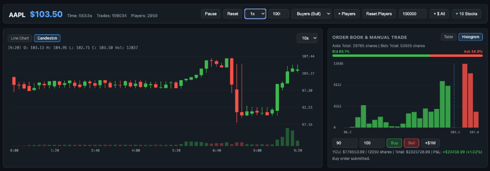

# Stock Market Game

A limit-order-book stock market simulator with autonomous trading agents and a live FastAPI + WebSocket dashboard.



## Features

- **Limit Order Book Exchange (`main.py`):** Price-time priority matching, partial fills, resting-order execution pricing, transaction log, and price history.
- **Autonomous Players:** Each player has a unique activity rate (`epsilon`) and a strategy (`buy_below`, `sell_above`, or `buy_sell` around a target price), with configurable short selling.
- **Live Dashboard (`dashboard.py` + `index.html`):**
  - Real-time WebSocket updates (`/ws`)
  - Line chart and Candlestick chart (`1s`, `5s`, `10s`, `30s`, `1m`, `2m`, `5m`) with volume bars and hover OHLCV readout
  - Order book table (with order cancellation) and bid/ask depth histogram + bid/ask % bar
  - Manual Buy/Sell trading, live P&L tracker, cash/stock injection, and Bull/Bear/Random player spawning
- **Configuration (`config.json`):** Centralizes stock, player, simulation, and server settings.

## Quick Start

```bash
python3 -m venv .venv
.venv/bin/pip install -r requirements.txt
```

Run the live dashboard (bound to `0.0.0.0` so multiple devices on the same network can join concurrently):

```bash
.venv/bin/fastapi dev dashboard.py --host 0.0.0.0 --port 5005
```

Then open `http://127.0.0.1:5005` locally or `http://<your-lan-ip>:5005` from other phones/laptops on your network (or `http://127.0.0.1:5005/docs` for the REST API).

### Cloud Run / Container Deployment

Because the live order book and market simulation run in-memory within a single shared market instance, deploy with `--max-instances=1` (and high per-instance concurrency, e.g. `--concurrency=80 --session-affinity`) so all connected devices share the same live exchange and session state.

To run a standalone simulation and save a matplotlib plot to `images/`:

```bash
.venv/bin/python3 main.py
```
